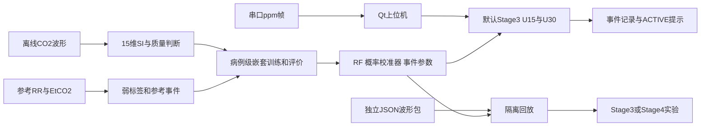

# NDIR 呼吸波形监测与 CF-REM 事件检测

本仓库保存“面向智慧医疗的高精度 NDIR 呼吸气体分析仪及智能诊断系统”项目的**上位机、模型训练相关代码和交接文档**。

截至2026-11-02，CF-REM已完成第0—4阶段实施与审查。电脑端默认使用 **Stage3 U15/U30 相对模式事件引擎**；四尺度融合仅作隔离回放实验，未进入默认路径。

研究目标是检测**参考EtCO₂低值／呼气CO₂消失样事件**。参考标签来自监护仪轨道，不能据此宣称临床确诊屏息；U0只表示节律范围正常，未评估气体交换。

> 本次不上传论文、专利、固件、原始缓存、运行数据库或EXE。详见[发布说明](PUBLICATION_NOTES.md)。

## 从哪里开始

| 目的 | 入口 |
|---|---|
| 不懂代码，想了解项目全貌 | [项目全景说明与接手指南](<模型训练代码/docs/项目全景说明与接手指南-截至第四阶段.md>) |
| 当前实施状态 | [状态汇总](<模型训练代码/docs/项目状态-单一事实源.md>)，冲突时核对最新修订报告、JSON和源码 |
| 最新审查依据 | [第四阶段修订1](<模型训练代码/report/第4阶段-实施报告-修订1.md>)、[第四阶段收尾](<模型训练代码/report/第4阶段-实施报告-收尾.md>) |
| 默认事件引擎 | [第三阶段修订1](<模型训练代码/report/第3阶段-实施报告-修订1.md>) |
| 模型与评价 | [第二阶段摘要](<模型训练代码/report/stage2/stage2_summary.md>) |
| 发布文件来源与指纹 | [PUBLICATION_MANIFEST.json](PUBLICATION_MANIFEST.json) |

## 目录结构

```text
ndir/
├─ 上位机代码/
│  ├─ run.py                  桌面程序入口
│  ├─ co2_monitor.py          Qt界面、串口、模拟、事件和回放
│  ├─ host_core/              Stage3/Stage4运行时、路径、回放
│  ├─ replay_data/            开发集示例回放
│  ├─ db_manager.py           SQLite存储
│  ├─ report_generator.py     旧业务HTML报告
│  ├─ excel_exporter.py       数据导出
│  └─ test_*.py               主机测试
├─ 模型训练代码/
│  ├─ features/               15维SI、质量、B0及旧12维
│  ├─ training/               RF、校准、事件、融合及评价
│  ├─ tools/                  标签、划分、回放导出、核验
│  ├─ preprocessing/、labels/ 旧路线预处理和标签
│  ├─ data_splits/            冻结病例ID和事件统计
│  ├─ models/                 RF、校准器、参数与研究模型
│  ├─ tests/                  算法测试和夹具
│  ├─ docs/                   冻结规范、交接指南
│  ├─ report/                 阶段报告和结果JSON
│  ├─ train.py                旧四分类训练入口
│  └─ experiment_*.py         旧实验脚本
├─ requirements.txt
├─ PUBLICATION_NOTES.md
└─ PUBLICATION_MANIFEST.json
```

保留两个中文目录名及相邻关系，是因为主机按此定位共享算法和模型；也可用`CFREM_TRAINING_ROOT`指定训练目录。

## 架构



新版输入只从CO₂波形计算，参考RR/EtCO₂只用于离线标签。相对归一化减少未知正增益和固定偏置的影响，不保证对非线性、削顶、噪声或响应变化都不敏感。

## 新旧算法区别

| 项目 | 旧四分类 | 当前CF-REM |
|---|---|---|
| 特征 | 12维、绝对幅度相关 | 15维SI及质量诊断 |
| 输出 | 正常／急促／屏息／异常 | U0/U1/U2概率及UNKNOWN、SUSPECT、ACTIVE |
| 窗口 | 90秒旧模型 | U15/U30默认，U60/U90扩展 |
| 模型 | `etco2_model_v2.onnx` | `models/stage2/u*_rf.joblib`及校准JSON |
| 入口 | `train.py` | `training/run_stage2.py`等分阶段入口 |

旧模型Accuracy约0.91不能代表新版事件或整机精度。概率校准不是标准气体标定。新版尚未完成STM32移植，固件不在本次发布范围。

## 安装与启动

建议使用独立环境。原工作区为Python 3.12.6、NumPy 2.3.1、SciPy 1.16.3、scikit-learn 1.7.2、joblib 1.5.2；依赖范围并非完整跨平台锁定环境。

```powershell
# 在仓库根目录
python -m venv .venv
.\.venv\Scripts\Activate.ps1
python -m pip install -r requirements.txt
python -m pip install -r '.\上位机代码\requirements.txt'
Set-Location -LiteralPath '.\上位机代码'
python run.py
```

若目录不相邻，在启动前将`CFREM_TRAINING_ROOT`设为“模型训练代码”实际绝对路径。新版运行依赖该目录的Python实现、规格JSON、joblib、校准器及事件参数，只有旧ONNX不够。

启动GUI会创建配置、日志、数据库，并按保留策略处理旧数据。当前只启用相对模式，绝对CO₂/EtCO₂隐藏；手动登记标定不能解锁C模式。

在隔离回放工作台加载`replay_data/dev_demo.json`，可选择Stage3或Stage4，再播放、暂停、倍速、跳转。示例是病例1的240秒开发集片段。

**顶部“启动模拟”会走正常数据库写入路径，与隔离回放不同。** 隔离回放算法输出不写生产设备、告警、事件表，不发生产通知，但GUI日志仍可能落盘。

## 测试与复现

```powershell
Set-Location -LiteralPath '.\模型训练代码'
python -m unittest discover -s tests -q
```

完整149项中，`test_stage2_data.TestStage2Data.test_no_window_cases_keep_truth_events`依赖原始病例7、106缓存。无缓存副本执行该命令为148项通过、1项缺数据报错；排除该项后，**148项无缓存测试通过**。临时仅在内存中将数据读取指向本机已有缓存后，发布副本**149项全部通过**，未把缓存上传。详见[核验记录](PUBLICATION_CHECKS.md)。部分上位机测试还依赖原始缓存或GUI数据库初始化，不能据文件存在推断克隆后全套测试均可通过。

完整研究使用250冻结病例：200开发、50 Final Test；开发集303可靠U2事件、60低支撑事件。新版Final Test未参与模型、阈值、校准和融合选择；Stage0曾为冻结划分统计参考事件数量。

本仓库没有原始缓存，不能直接复现全量实验。下面入口供持有并核验缓存的开发者使用，会写模型、参数和结果：

```powershell
python training/run_stage2.py
python training/run_stage3.py
python training/run_stage4.py
```

不要为适配现有数据重建冻结划分，不用Final Test调参。旧`train.py`不是新版一键入口；历史XGBoost/LightGBM实验另需可选依赖。

## 开发集事件结果

来自[比较结果](<模型训练代码/report/stage4/comparison.json>)：病例级外层验证，200开发病例、303可靠事件、约587.72可评分小时。不是新版Final Test或实物结果。

| 方案 | Recall | PPV | 事件F1 | 误报/小时 |
|---|---:|---:|---:|---:|
| Stage3 U15 | 0.624 | 0.149 | 0.2402 | 1.841 |
| Stage3 U30 | 0.703 | 0.182 | 0.2888 | 1.632 |
| 单尺度U60 | 0.601 | 0.208 | 0.3095 | 1.176 |
| 单尺度U90 | 0.545 | 0.216 | 0.3093 | 1.019 |
| 四尺度融合 | 0.680 | 0.238 | 0.3527 | 1.121 |

融合F1增加**4.32个百分点**，未达冻结5个百分点门槛，`benefit.pass=false`，因此未切换默认路径。误报负担仍然较高。

同一25Hz输入下150秒主机/独立参考核验通过；原始100Hz与25Hz路径不完全等效，记录中融合ACTIVE起点为75秒与52.5秒，不能宣称无条件完全一致。

## 已知边界

- 新事件写`event_records`，旧告警页和HTML报告主要仍读`alarm_records`，新事件报告闭环尚未完成。
- 已记录溢出日志属性名不一致等问题，见交接指南；本次发布没有修复业务代码。
- 当前帧协议没有独立版本字段、样点时间戳或帧序号，旧电压与当前ppm协议不能混用。
- 标准气体标定、当前板上固件确认、长时整机验证、新版最终测试、云服务和新版独立EXE不列为已完成。
- 历史文档可能保留旧描述，以最新修订报告、JSON和源码核对。

本仓库未新增开源许可证，不据公开可见性重新声明项目、数据或第三方依赖的许可。
