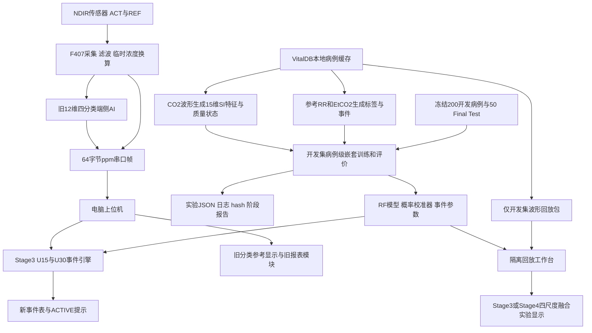

# 项目全景说明与接手指南

**项目：面向智慧医疗的高精度 NDIR 呼吸气体分析仪及智能诊断系统**  
**核查日期：2026-11-02；范围：截至 CF-REM 第四阶段审查通过后的工作区**  
**读者：不了解代码、需要掌握项目现状的负责人，以及后续接手的开发者**

本文重新核对了实际源码、模型、数据划分、实验结果和既有文稿，不把此前对话记忆或旧 README 当作唯一依据。本次只新增这份说明，不修改代码、固件、模型、数据划分或原有文稿；没有启动新训练、连接实物或开展论文、专利实施。

请先读第1—5节建立全貌，再按需要查文件地图。本文中的“已经实现”表示找到了对应代码；“已经验证”会同时限定测试方式和范围。能运行的原型、离线实验通过、实物经过标准气体标定、临床有效，是四个不同层次。

## 阅读导航

1. [现在到底做到了什么](#1-现在到底做到了什么)
2. [项目代码在哪里](#2-项目代码在哪里)
3. [必须先认识的词](#3-必须先认识的词)
4. [整个项目的架构](#4-整个项目的架构)
5. [为什么有新旧两套算法](#5-为什么有新旧两套算法)
6. [数据、标签和事件怎么定义](#6-数据标签和事件怎么定义)
7. [新版算法如何工作](#7-新版算法如何工作)
8. [现在的结果应该怎样理解](#8-现在的结果应该怎样理解)
9. [模型训练目录文件地图](#9-模型训练目录文件地图)
10. [上位机目录文件地图与实际行为](#10-上位机目录文件地图与实际行为)
11. [固件工程与硬件链路](#11-固件工程与硬件链路)
12. [串口协议](#12-串口协议)
13. [论文、专利及周边资料现状](#13-论文专利及周边资料现状)
14. [哪些完成了、哪些仍未完成](#14-哪些完成了哪些仍未完成)
15. [怎样查看和运行项目](#15-怎样查看和运行项目)
16. [验证证据及其边界](#16-验证证据及其边界)
17. [当前已知问题与不确定项](#17-当前已知问题与不确定项)
18. [版本、备份和交接](#18-版本备份和交接)
19. [负责人常见问题](#19-负责人常见问题)
20. [证据索引与建议阅读顺序](#20-证据索引与建议阅读顺序)
21. [附录：历史脚本、测试和文件类型](#21-附录历史脚本测试和文件类型)

## 1. 现在到底做到了什么

目前可以准确描述为：**已经建立了一个包含传感采集源码、旧模型端侧部署源码、本地桌面上位机，以及新版呼吸波形事件检测研究流程的工程原型；新版完成了开发集训练、评价、事件引擎、隔离回放、多尺度实验及第四阶段审查。**

默认上位机使用新版 **Stage3 的 U15/U30 相对模式事件引擎**。四尺度融合已经做出来，但因为没有达到预先规定的收益门槛，保留在隔离回放中作为实验选项。设备端现有 AI 仍是旧版12维四分类模型，新版15维事件流程没有移植到 STM32。

这意味着你已经有了可研究、可测试、可演示的主要软件基础，但**还没有“整机临床准确率已验证”的结论**。标准气体标定、当前实物固件版本确认、长时间硬件联调、新版 Final Test 模型性能评价和文稿同步，都不能写成已经完成。

| 负责人最关心的事 | 当前实际状态 |
|---|---|
| 新版算法是否已有代码、模型和结果？ | 有，见训练目录的 `features/`、`training/`、`models/`、`report/`。 |
| 新版是否只是计划？ | 已实施至第四阶段，审查已通过；第五阶段未由本报告启动。 |
| 上位机默认用什么？ | U15/U30两个独立事件引擎；旧四分类仍可能显示为参考信息。 |
| 是否四尺度融合全面上线？ | 没有；仅隔离回放实验可选。 |
| 是否必须先标定才能做一切？ | 新版相对特征在限定条件下减少对绝对浓度的依赖；绝对浓度测量和旧固件分类仍依赖真实标定。 |
| 是否已经有云平台？ | 所核查应用代码是本地 Qt 桌面程序；未见已实现的云服务、数据上传或专用蓝牙连接模块。 |
| 硬件是否完全没编译过？ | 有历史编译日志，不能再称从未编译；但不等于当前所有未提交源码都已重新编译并烧录验证。 |
| 论文、专利是否已跟上新版？ | 没有。现有稿件主要仍描述旧版，部分资料还更早。 |

## 2. 项目代码在哪里

总目录是 E:/大创/任务书（本机路径未发布）。**当前项目不是一个文件夹就包含全部可交付物**，几个目录彼此依赖，还存在历史副本。

```text
E:\大创\任务书\
├─ 模型训练代码\        新版算法、旧版训练、数据缓存、模型、实验、审查文档
│  ├─ features\         新旧特征与新版质量判断
│  ├─ training\         训练、概率校准、事件评价、融合与消融
│  ├─ tools\            标签/事件统计、划分、回放导出、核验工具
│  ├─ cache\            真实数据和计算缓存
│  ├─ data_splits\      冻结病例清单
│  ├─ models\           新版模型和参数
│  ├─ report\           各阶段报告、JSON结果、日志、hash
│  ├─ docs\             规范、计划、本报告
│  ├─ ndir-f407\        与训练档案对应的F407采集/旧AI工程（下文称A）
│  └─ ai\               X-CUBE-AI相关工程和生成资产
├─ 上位机代码\          电脑上的PySide6监测程序、数据库、回放和导出
├─ 单片机代码\          当前实际只有co2test.zip，属于另一条旧HAL工程
├─ ndir_stm\            另一套F407工程（下文称B）和旧F103工程
├─ 论文\                中文LaTeX、图、硬件Word稿、专利初稿
├─ 英文版论文\          目前主要仍是中文稿副本和模板，不能按目录名判断完成
├─ 中期\                较早的项目书和答辩材料
├─ 参考资料\            本次发现的主要是硬件手册、原理图和尺寸资料
└─ PCB\、build\、dist\、若干zip/exe/视频/旧模型
                       周边工程或历史输出，不能直接当作当前发布版
```

| 你要找的内容 | 应去的位置 | 最容易拿错的东西 |
|---|---|---|
| 当前算法怎么实现 | [模型训练代码](<..>) | 根目录 `train.py` 是旧路线入口，不是新版分阶段入口。 |
| 当前桌面程序源码 | [上位机代码/run.py](<../../上位机代码/run.py>) | 现有 EXE 未核实对应当前源码。 |
| 当前相对模式模型 | [models/stage2](<../models/stage2>) | 两个根目录的旧 ONNX不是新版模型。 |
| 当前配套F407源码 | 模型训练代码/ndir-f407（关联材料未随本次代码发布） | `单片机代码/co2test.zip` 和 `ndir_stm/ndir-f407` 不等价。 |
| 当前实验数字 | [report](<../report>) | 旧 README、旧论文里的0.91不能代替新版事件结果。 |
| 当前中文论文源稿 | 论文/paper_latex（关联材料未随本次代码发布） | 根目录 `main.pdf` 比 `out/main.pdf` 更旧，二者内容不同。 |
| 现有专利草稿 | 论文/zhuanli（关联材料未随本次代码发布） | 草稿存在不等于已提交或已授权。 |

## 3. 必须先认识的词

| 词 | 不需要编程知识的解释 | 在本项目中的注意点 |
|---|---|---|
| NDIR | 利用气体对特定红外波段的吸收来测浓度的方法 | 算出浓度需要传感链路、标定和补偿，算法不能替代这些。 |
| ACT / REF | 测量通道和参比通道 | 固件主要利用两路比值，减少共同光源变化的影响。 |
| 波形 | 按时间排列的一串传感值 | 一次呼气通常会形成一个峰；平坦也可能是失联或测量问题。 |
| ppm / mmHg | 浓度比例单位／分压单位 | 代码用 `ppm×0.00076` 作标准大气压下的换算；乘系数不等于完成标定。 |
| RR | 每分钟呼吸次数 | 监护仪参考RR、波形估计RR、旧模型F11不是可以混用的量。 |
| EtCO₂ | 呼气末二氧化碳参考值 | 离线可用于生成弱标签；新版实时输入不额外提供监护仪EtCO₂。 |
| 病例 | 一名受试者的一段记录 | 同一个病例的重叠窗口不能拆到训练和验证两边。 |
| 窗口、步长 | 每次查看多久的数据；隔多久再看一次 | U15是看过去15秒，每7.5秒更新，不能理解成15秒内必然检测出来。 |
| 特征 | 把一长段波形概括成若干数字 | 例如周期、峰数、规律性；新版有15个。 |
| 标签／真值 | 训练时用来告诉模型“这一段按规则算哪类”的答案 | 来自监护仪参考轨道，是设备参考弱标签，不是医生逐例确诊。 |
| 随机森林 RF | 一组决策树共同给出预测的模型 | 新版仍采用30棵树、最大深度8。 |
| SI／尺度不变 | 减少正比例增益和固定偏置变化对特征的影响 | 不意味着对所有噪声、非线性、削顶、时间响应都不敏感。 |
| 概率校准 | 让模型报出的概率更符合验证数据中的频率 | 这是软件统计操作，与标准气体标定完全不同。 |
| UNKNOWN／弃权 | 当前证据不够，系统不下结论 | 不是“正常”，也不是程序崩溃。 |
| SUSPECT / ACTIVE | 可疑提示／经过持续证据确认的算法事件 | 两者都不是临床确诊。 |
| Final Test | 最后保留、不能用来反复改模型的病例集 | 新版50例未用于模型调参或性能评价；早期统计冻结时记录过参考事件数量。 |
| OOF | 验证预测来自没有训练过该病例的模型 | 当前新版主结果来自开发集病例级外层验证。 |
| 消融 | 去掉某部分，比较它到底有没有帮助 | 增加一个模块不自动等于提高效果。 |
| hash／SHA256 | 文件内容的指纹 | 用于核对“报告对应的文件是不是这一个版本”。 |
| commit | Git中一次保存下来的版本记录 | 本地未提交改动不会因为知道commit号就自动得到保存。 |

## 4. 整个项目的架构

必须分清**离线研究链路、实物实时链路、隔离回放链路**。它们共享一部分算法，但证据不能互相替代。



### 4.1 离线研究链路

电脑读取 VitalDB 缓存，参考轨道负责生成答案，CO₂波形负责生成输入。按病例划分训练与验证，选定模型权重、概率校准和事件阈值，输出模型及结果。**训练程序并不直接控制传感器。**

### 4.2 实物实时链路

硬件两路信号 → STM32采集及换算 → 每帧发送5个ppm值 → 电脑接收 → 默认新版U15/U30分析 → 新事件记录及活动事件通知。固件另有旧四分类结果随帧上报，但相对模式不允许它驱动旧告警。

### 4.3 隔离回放链路

读取独立JSON波形包，以指定速度送给独立运行时，可暂停、重启、跳转，并选择Stage3或Stage4。它用于研究和演示；算法输出不写生产设备、告警、事件三张表，也不发生产通知。GUI自身仍可能写运行日志，加载错误可能进入操作日志表，所以不能把“隔离”解释成整个程序零磁盘写入。

## 5. 为什么有新旧两套算法

旧方案依赖绝对波形幅度。传感器没有标准气体标定时，即使人在正常呼吸，波峰也可能低于固定寻峰阈值，旧模型由此得出不可信的四分类。CF-REM改造因此把重点移到相对形态、质量拒判和事件时间过程。

| 项目 | 旧版绝对四分类路线 | 当前CF-REM相对事件路线 |
|---|---|---|
| 主要入口 | `train.py` | `training/run_stage2.py`、`run_stage3.py`、`run_stage4.py` |
| 特征 | `features/extract_features.py`，12维 | `features/si_features.py`，15维 |
| 窗口 | 训练90秒、45秒步长 | 15/30秒默认；60/90秒为扩展实验 |
| 预测目标 | 正常、急促、屏息、异常四类 | RF学U0/U1/U2，质量与规则处理平坦/UNKNOWN，事件引擎判SUSPECT/ACTIVE |
| 浓度依赖 | 均值、峰幅和固定寻峰阈值受标定影响明显 | 先做相对归一化；仍受非线性、削顶、噪声、时基和域差异影响 |
| 模型文件 | 根目录 `etco2_model_v2.onnx` | `models/stage2/u*_rf.joblib`及相邻校准JSON |
| STM32状态 | 有C特征和生成推理代码 | 尚未移植新版15维、质量层、概率校准和事件融合流程 |
| 电脑默认用途 | 旧分类参考显示、本机旧ONNX对照 | Stage3事件检测 |
| 评价 | 旧四分类窗口Accuracy/Macro-F1 | 新版窗口指标、事件召回、PPV、F1、误报/小时、延迟、弃权 |

旧ONNX在训练和上位机两处的内容相同，580,463字节，SHA256为 `a0d41106981211ed9d3a5214424cfd9c7a21480960c2fe609191fce454c348c2`。这个文件不是新版U15/U30模型。

旧F11把峰数乘`60/30`；模型在这个数值上训练，不能只改这一行就继续用旧模型。旧固件另用`峰数×60/90`显示实际窗口呼吸率。新版`peak_rate`则按真实窗口长度归一化。三者必须区分。

## 6. 数据、标签和事件怎么定义

### 6.1 本地数据与划分

cache/vitaldb（关联材料未随本次代码发布）实际有250个压缩病例文件，约141 MB（十进制字节统计）。每例保存`co2`波形及`rr/etco2`参考轨道，按100Hz网格处理。100Hz是数据处理目标采样率，不等于原始仪器采样率，更不等于样机实际采样率。

| 文件 | 作用 | 当前冻结内容 |
|---|---|---|
| [cases_250.json](<../data_splits/cases_250.json>) | 总病例清单 | 250例 |
| [cases_200.json](<../data_splits/cases_200.json>) | 开发集清单 | 200例；可靠U2事件303个，涉及143例 |
| [final_test_seed42.json](<../data_splits/final_test_seed42.json>) | 新版最终测试清单 | 50例，模型性能评价封存 |
| [case_event_counts.json](<../data_splits/case_event_counts.json>) | 逐病例事件统计 | 支撑事件分层和复算 |
| [split_manifest.json](<../data_splits/split_manifest.json>)及`.sha256` | 划分方法与内容指纹 | 用来发现病例清单被替换或改动 |

开发集另有60个低支撑事件，涉及46例。它们不充当可靠正例，也不改成负例。早期Stage0为冻结划分统计过全250例，包括Final Test的参考事件计数；因此“封存”准确含义是**不用于训练选择和当前模型性能报告**，不是从未读取过任何参考统计。

### 6.2 新版标签

U2正式名称是**参考EtCO₂低值／呼气CO₂缺失样事件**。参考值低可能与呼吸暂停有关，也可能来自漏气、脱管、采样管或测量问题。没有独立气流、呼吸努力或人工确认，不能把U2直接称为临床确诊屏息。

| 标签 | 当前规则和含义 |
|---|---|
| U2 | 窗口与可靠U2事件重叠≥50%，优先级最高 |
| U1 | 未命中事件规则且参考RR≥18，表示参考RR急促 |
| U0 | 未命中事件规则且7≤参考RR<18，只表示节律正常，未评估气体交换 |
| U3 | 3≤参考RR<7，慢呼吸规则观察态，不是RF第四类 |
| ambiguous | RR<3但没有相应EtCO₂事件证据，不强行标屏息 |
| ignore | 可靠事件边界，重叠10%至不足50% |
| ignore_low_support | 低支撑事件或其边界，不纳入可靠正负例 |
| unlabeled / other | 参考缺失、点不足或规则不覆盖，不能当正常 |

RF训练只使用**质量状态为VALID且真值为U0/U1/U2**的行。标签分离是指参考值不直接作为输入；CO₂波形与EtCO₂仍有同源测量关系，不能由此宣称独立临床金标准。

### 6.3 参考事件的时间定义

实现位于 [tools/stage0_common.py](<../tools/stage0_common.py>)。对参考EtCO₂：非正值与缺失值按无效处理；最多前向保持10秒，再取1秒网格；`EtCO₂<10`构成低值；相隔不超过10秒且间隙没有未知段才合并；先合并，再去掉不足10秒的事件。

“可靠”要求事件内低值网格至少关联到两段实际低值原始读数运行段。不能把一次读数被保持出来的十个网格点说成十条独立证据。读数来源可能略早于整数秒事件起点，因此实现要追溯前向保持的来源，而不是只截事件区间数样点。

### 6.4 怎样评价一次告警

一条告警最多匹配一个真值，一个真值最多匹配一条告警；重复告警不能都计成功。ACTIVE匹配需要同病例、同类且有实际有效重叠：至少1秒，并达到较短区间时长的5%。参考未知和低支撑时域不能简单当正常时域计算误报。

决定时间必须是窗口结束后实际可用的时刻，不能回填到窗口起点制造“提前发现”。SUSPECT单独报告事件前提示与事件后检出，不混入ACTIVE主指标。

## 7. 新版算法如何工作

### 7.1 相对归一化

每个窗口先计算`B=q10`、`A=q90-q10`，再用`z=(x-B)/A`表达相对波形。对于正增益和固定偏置变化，许多特征可以保持不变。但真实设备有浓度限幅、非线性和时间响应，不能直接从公式推出“任意设备免标定都准确”。

真正全平时`A=0`，不直接除零，也不自动丢弃。代码区分完全恒定与分位数退化但仍有稀疏脉冲的波形，后者是伪迹并进入UNKNOWN。

### 7.2 15维特征分别是什么

冻结参数是 [feature_spec_si_v2.json](<../features/feature_spec_si_v2.json>)，实现是 [si_features.py](<../features/si_features.py>)。

| 序号／名称 | 用大白话理解 |
|---|---|
| 1 `rel_mean` | 归一化波形平均位于什么高度 |
| 2 `rel_std` | 相对波动有多大 |
| 3 `rel_range` | q99到q1的范围相对于A有多大 |
| 4 `skewness` | 波形分布是否明显偏向一边，使用中心标准化偏度 |
| 5 `peak_interval_mean` | 相邻呼吸峰平均隔多久 |
| 6 `peak_interval_std` | 呼吸间隔变化有多大 |
| 7 `peak_width_mean` | 每个峰大致持续多久 |
| 8 `plateau_ratio` | 接近高平台的样点比例，当前按z≥0.85 |
| 9 `peak_count` | 窗口内找到几个有效峰 |
| 10 `mean_prominence` | 峰相对于周围背景的相对突出程度 |
| 11 `peak_rate` | 按窗口时长换算的每分钟峰数 |
| 12 `rhythm_confidence` | 峰间隔越稳定，规律性分数越高 |
| 13 `band_ratio` | 呼吸频段0.05—0.6Hz能量占0—2Hz非直流能量的比例 |
| 14 `acf_peak` | 波形在1.5—8秒延迟范围内有多像自己，反映周期性 |
| 15 `flat_run_frac` | 最长低平段占窗口的比例 |

寻峰使用相对高度、相对突出度和峰宽约束；初次峰不足时，在周期性和噪声条件满足后才采用第二组较宽松参数。它不是简单把旧绝对阈值换一个常数。

### 7.3 质量层先决定是否可信

| 状态 | 含义与后续 |
|---|---|
| GAP | 缺失比例>10%或连续缺口>2秒，进入UNKNOWN |
| SATURATED | 已知测量上下限下的饱和；需要rail信息，不能宣称VitalDB已验证全部硬件饱和情形 |
| POLARITY_INVALID | 能识别的反向波形情形；负增益加较大正偏置不能保证辨认 |
| QUANTILE_ARTIFACT | A为0但有限样点仍变化，例如稀疏脉冲，不能当呼吸消失 |
| NOISY | 非零幅度窗口的高频残差比例过高，拒判 |
| FLAT_HISTORY_UNKNOWN | 平坦且历史不足，不能确认 |
| FLAT_NO_HISTORY | 有历史但从未有可信呼吸证据，不能确认 |
| FLAT_WITH_HISTORY | 平坦且近期有可信呼吸证据，是较强的U2候选 |
| FLAT_EVER_HISTORY | 更早有可信呼吸但近期没有，只能支持低置信可疑态 |
| VALID | 质量可用，再交给RF预测 |

历史以不重叠15秒片段建立，至少有30秒过去信息才足够判断；近期范围300秒。只有通过质量检查且SI峰数≥2的片段才贡献可信呼吸证据和参考幅度。历史不能包含当前窗口之后的数据。

### 7.4 规则、模型和概率校准

B0规则基线不训练模型，用平坦历史证据和峰率给出U0/U1/U2/U3/UNKNOWN，是比较“机器学习是否值得”的基准。

RF使用30棵树、最大深度8，输出U0/U1/U2概率。开发时比较了不同U2权重，并在病例级内层验证中选择概率校准方法和阈值。最终保存模型和外层评价模型是不同用途：保存模型供演示或候选部署；外层未见病例预测用于报告性能。

### 7.5 事件引擎

单个窗口有高概率，不必立即认定持续事件。引擎经过WAITING、UNKNOWN、NORMAL、SUSPECT、ACTIVE等状态，使用进入/退出阈值和严格连续次数减少跳变。

当前全开发集选出的Stage3参数：两尺度的SUSPECT阈值0.1、ACTIVE进入0.3、退出0.1；U15需要连续2次进入证据，U30需要1次；二者退出都需连续2次。**这些是保存的演示候选参数，不是临床标准。** 每个尺度独立运行，不是先U15再交给U30确认。

遇到UNKNOWN、中断或超步长缺失决策，会结束输出并清空证据。每次转换携带事件编号、转换序号和时间快照，防止事件结束后丢失开始时刻。只有更早历史的平坦候选不能直接进入ACTIVE。

### 7.6 四尺度融合

Stage4增加U60/U90，在7.5秒网格上取每个尺度仍有效的最新一次证据，进行归一化加权及时间衰减，再送同类事件引擎。每尺度每时刻最多一票，不把重叠窗口当独立概率相乘。

| 尺度 | 观察窗口 | 更新步长 | 当前定位 |
|---|---:|---:|---|
| U15 | 15秒 | 7.5秒 | 上位机默认事件引擎之一 |
| U30 | 30秒 | 15秒 | 上位机默认事件引擎之一 |
| U60 | 60秒 | 30秒 | 最佳单尺度实验候选；未因此替换默认路径 |
| U90 | 90秒 | 45秒 | 长窗实验候选 |

## 8. 现在的结果应该怎样理解

### 8.1 先区分指标

Recall表示真事件抓住多少；PPV/Precision表示报警中多少匹配真事件；F1综合二者；FA/h表示每可评分小时有多少误报。Accuracy容易受大量正常窗口影响，不能只看“九成正确”。窗口F1与连续事件F1回答不同问题，数值不可直接比较。

例如U30事件PPV约0.182，表示在这一弱标签匹配规则和开发集范围内，约18.2%的可评分告警匹配到可靠参考事件。其余不等于已由医生证实“全无问题”，但明确显示当前告警负担仍高。

### 8.2 Stage2：窗口级预测

来自 [stage2_summary.md](<../report/stage2/stage2_summary.md>)，病例级嵌套外层OOF、真值U0/U1/U2；包含冻结质量/规则分流，不是单纯VALID行RF消融。

| 尺度 | Macro-F1 | U2精确率 | U2召回率 | U2 F1 | 同口径B0 U2 F1 |
|---|---:|---:|---:|---:|---:|
| U15 | 0.8347 | 0.546 | 0.649 | 0.593 | 0.577 |
| U30 | 0.8185 | 0.416 | 0.738 | 0.532 | 0.503 |

### 8.3 当前事件级结果

数据来自 [comparison.json](<../report/stage4/comparison.json>)，共200开发病例、303可靠事件、60低支撑事件单列；可评分约587.72小时。以下是开发集外层评价，**不是新版Final Test或实物测试结果**。

| 方案 | TP / FN / FP | 召回率 | PPV | 事件F1 | 误报/小时 |
|---|---|---:|---:|---:|---:|
| 默认U15事件引擎 | 189 / 114 / 1082 | 0.624 | 0.149 | 0.2402 | 1.841 |
| 默认U30事件引擎 | 213 / 90 / 959 | 0.703 | 0.182 | 0.2888 | 1.632 |
| 单尺度U60 | 182 / 121 / 691 | 0.601 | 0.208 | 0.3095 | 1.176 |
| 单尺度U90 | 165 / 138 / 599 | 0.545 | 0.216 | 0.3093 | 1.019 |
| 四尺度融合 | 206 / 97 / 659 | 0.680 | 0.238 | 0.3527 | 1.121 |

最佳单尺度在各外层训练折的内层选择中均为U60。融合相对它的F1提高0.0432，即4.32个百分点；预先门槛要求至少5个百分点，同时满足误报、召回和配对区间条件。**即使有统计改善，也没有通过完整工程收益判据，因此没有进入默认路径。**

长窗B0也有竞争力：U60/U90规则事件F1约0.2999/0.3094。不能把长窗带来的所有收益都说成融合或复杂模型的贡献。

### 8.4 已确认的负结果与局限

正确插入5秒、500点缺口后，U15固定干净质量口径的窗口Macro-F1从约0.7115降至0.3201；旧“5秒丢点几乎无影响”已经撤回。这项窗级压力实验固定质量状态，不能用于证明完整质量层能吸收长缺口。

RF-only特征消融只在VALID的U0/U1/U2评价，U15/U30的U2支持数仅702/235。新增的band_ratio、acf_peak、flat_run_frac没有显示稳定的正增量；去掉flat_run_frac时U30 U2-F1反而提高约2.9个百分点。没有据此改主模型，也不能把窗级消融直接外推为事件级收益。

同一25Hz输入下，主机与独立参考在病例1的150秒片段上匹配；但100Hz原始输入与25Hz降采样再重采样不同：最大特征差1.0，最大单尺度概率差约0.116，融合ACTIVE开始时刻为75秒与52.5秒，相差22.5秒。不能写“端云完全一致”。

### 8.5 旧版0.91应放在哪里

旧文档的Accuracy约0.910、Macro-F1约0.888，对应12维四分类旧实验，不对应上表。旧路线还存在100树研究模型、30树部署模型，以及39例/9907窗和40例/10311窗等不同实验群体。只能在明确实验版本和结果来源的前提下引用，不能作为当前整机精度。

## 9. 模型训练目录文件地图

以下路径相对于 [模型训练代码](<..>)。每个单元的生成结果与源码不同，不要把自动结果文件当作修改算法的入口。

### 9.1 新版核心源码

| 文件 | 负责什么 | 谁使用它 |
|---|---|---|
| `features/feature_spec_si_v2.json` | 冻结15维顺序、归一化、寻峰、频带和质量参数 | 特征、质量、数据缓存、主机 |
| `features/si_features.py` | 提取15维及平坦、噪声、缺口等诊断信息 | 训练及主机共享 |
| `features/quality_states.py` | 质量状态、可信历史片段和因果历史索引 | 新版数据与主机 |
| `features/rule_baseline.py` | 不训练的B0规则基线 | 对照实验 |
| `tools/stage0_common.py` | 读缓存、参考事件、可靠支撑、窗口标签及统计底层 | 多阶段共同依据 |
| `tools/build_frozen_splits.py` | 构建冻结病例与分层划分 | Stage0；不是日常启动步骤 |
| `tools/recompute_stage0_stats.py` | 重新计算标签和事件统计 | 检查数字出处 |
| `tools/quality_state.py` | Stage0历史结构及早期质量定义 | 新版沿用其历史结构；不要与Stage1完整质量模块混淆 |
| `tools/event_matching.py` | 冻结的一对一事件匹配规则 | 测试和评价语义基础 |
| `tools/analyze_flat_quality.py` | 分析平坦、缺失等状态 | Stage0诊断 |
| `tools/run_stage1_rule_baseline.py` | 运行U15/U30规则基线评估 | Stage1结果生成 |
| `tools/stage1_quality_demo.py` | 用合成波形展示状态区分 | 状态测试演示，不是实物结果 |
| `training/stage2_data.py` | 构建各尺度SI特征、质量、标签缓存，验证指纹与病例隔离 | Stage2—4 |
| `training/run_stage2.py` | 病例级外5折、内3折；RF权重、校准、阈值选择与保存 | 新版短窗训练主入口 |
| `training/stage2_calibration.py` | 温度缩放、多项logistic校准和概率指标 | 训练及主机共享 |
| `training/stage2_eval.py` | 窗口指标、因果告警代理、可评分时域裁剪、bootstrap | Stage2及后续评价 |
| `tools/render_stage2_results.py` | 从结果JSON生成可读摘要 | 文档生成 |
| `training/stage3_event_engine.py` | 连续证据、SUSPECT/ACTIVE、迟滞、中断和事件快照 | 训练评价及主机共享 |
| `training/stage3_eval.py` | 把事件引擎输出放到冻结评分口径评价 | Stage3—4 |
| `training/run_stage3.py` | 选择单尺度事件参数并外层验证 | Stage3实验入口 |
| `tools/export_stage3_replay_pack.py` | 仅从开发集导出波形回放包 | 主机隔离回放 |
| `training/run_stage4.py` | 四尺度嵌套评价、最佳单尺度比较和收益判定 | Stage4主入口 |
| `training/stage4_fusion.py` | 有界因果共识融合、有效期和权重选择 | 离线与实验主机 |
| `training/stage4_perturb.py` | 波形增益、偏置、噪声、缺口、滞后等扰动及实际缺口审计 | 鲁棒性实验 |
| `training/stage4_robustness.py` | 固定模型与真值下的窗口/事件压力实验 | 鲁棒性结果生成 |
| `training/stage4_ablation.py` | 尺度、时序、融合方式和RF-only特征消融 | 贡献分析 |
| `tools/stage4_host_reference.py` | 从波形独立建主机参考、比较帧数/特征/概率/事件，汇总失败 | 主机一致性核验 |
| `tools/verify_stage4_host_consistency.py` | 运行150秒对照，保存结果并据一致性返回0或1 | 研究核验入口 |

### 9.2 模型和参数文件

| 目录／文件 | 内容与意义 |
|---|---|
| `models/stage2/u15_rf.joblib` | U15随机森林，971,609字节 |
| `models/stage2/u30_rf.joblib` | U30随机森林，785,257字节 |
| `models/stage2/u60_rf.joblib` | U60随机森林，549,242字节；仍放在stage2目录是复用训练资产结构 |
| `models/stage2/u90_rf.joblib` | U90随机森林，461,242字节 |
| 同名`u*_calibrator.json` | 概率校准器；U15/U30/U60为温度校准，U90保存none |
| 同名`u*_meta.json` | 特征规格、指纹、权重、阈值、模型hash和测试封存说明 |
| `models/stage3/u15_event_params.json`、`u30_event_params.json` | 默认上位机事件引擎参数 |
| `models/stage4/u*_event_params.json`、`fusion_event_params.json` | 四尺度实验及融合参数 |
| `models/stage4/fold_configs.json` | 各外层折内选择配置，追踪研究结果 |
| `models/stage4/folds/` | 外层研究模型及校准器，供受影响实验复算；不是默认主机模型路径 |

完整运行需要特征规格、模型、概率校准器、事件参数以及共享Python实现共同匹配。只复制一个joblib或一个ONNX，不是交付完整新版程序。

### 9.3 缓存、结果与规范

| 位置 | 内容 | 要不要保留 |
|---|---|---|
| `cache/vitaldb/` | 250例原始缓存，含开发与封存病例 | 应备份；不是随意再下载就一定等价 |
| `cache/stage2/u15/u30/u60/u90.npz`及对应`*_meta.json` | 各尺度计算缓存 | 应保留用于复算，算法/规格变更后靠指纹判断失效 |
| `report/stage0/` | 统计、质量分析、初始状态和hash | 追溯事实起点 |
| `report/stage1/` | B0、状态演示、结果 | 规则与质量证据 |
| `report/stage2/` | 窗口/原始事件代理、校准、折划分、摘要 | 不与Stage3 ACTIVE混用 |
| `report/stage3/` | 默认事件引擎的修订结果 | 实时算法离线证据 |
| `report/stage4/` | 四尺度、融合、鲁棒性、消融、一致性、缺口审计 | 当前实验主证据 |
| `report/第N阶段-*.md`、`*.log` | 人可读报告与实际命令输出 | 以最新修订及补充为准，历史报告保留 |
| `docs/specs/` | 标签、事件、匹配、质量、模型和融合口径 | 是实验规则，不是程序启动入口 |
| `docs/CF-REM-改造计划*.md` | 计划与审查意见 | 计划数字不自动成为实测数字 |
| `docs/项目状态-单一事实源.md` | 汇总状态与导航 | 前部更新较新，但末尾仍有修订前数字；遇冲突查最新报告、JSON和源码 |

当前开发缓存窗口数：U15 **309,706**，U30 **154,626**，U60 **77,077**，U90 **51,245**。这是窗口数，不是独立病例数或事件数。RF可训练VALID行分别少于这些总数。

### 9.4 旧路线文件

`train.py`实际配置为200病例、90秒窗口、45秒步长，复用`preprocessing/`、`features/extract_features.py`、`labels/build_reference_labels.py`和`training/train_rf.py`。它与新版`training/stage2_data.py`的冻结200例并不因数量相同就自动是同一划分。

`preprocessing/build_cases.py`负责旧病例筛选及加载，`make_windows.py`负责旧窗口切分，`signal_processing.py`负责缺口、离群点等处理。`labels/build_reference_labels.py`生成旧四类参考标签；`training/train_rf.py`保存旧RF及病例交叉验证逻辑。

`train_spontaneous.py`是另一个旧路线探索，尝试用通气设定轨道筛自主呼吸时段，可能额外联网下载，输出另一个ONNX。文件存在不代表已验证解决自主呼吸域差异。

## 10. 上位机目录文件地图与实际行为

### 10.1 文件职责

| 文件／目录 | 你应该怎样理解 |
|---|---|
| [run.py](<../../上位机代码/run.py>) | 推荐源码启动入口，创建Qt应用和主窗口；版本字符串1.0.0不是算法版本号 |
| [co2_monitor.py](<../../上位机代码/co2_monitor.py>) | 大部分界面和业务集中在这里：串口、图、旧AI、事件、模拟、历史、回放、导出 |
| [host_core/paths.py](<../../上位机代码/host_core/paths.py>) | 找相邻训练目录，支持`CFREM_TRAINING_ROOT`环境变量 |
| [host_core/runtime.py](<../../上位机代码/host_core/runtime.py>) | Stage3共享历史、25→100Hz重采样、U15/U30窗口、特征、质量、概率和事件 |
| [host_core/stage4_runtime.py](<../../上位机代码/host_core/stage4_runtime.py>) | 隔离实验使用四尺度与融合，含只读审计接口 |
| [host_core/replay.py](<../../上位机代码/host_core/replay.py>) | 包来源校验、累计信号时间、倍速、暂停、重启和跳转重建 |
| [db_manager.py](<../../上位机代码/db_manager.py>) | SQLite存储、查询、迁移、保留期清理 |
| [config_manager.py](<../../上位机代码/config_manager.py>)与`config.json` | 通信、窗口、声音等设置；旧告警阈值不等于新版事件阈值 |
| [log_manager.py](<../../上位机代码/log_manager.py>) | 控制台、文件与界面日志 |
| [paths.py](<../../上位机代码/paths.py>) | 应用数据/资源路径；与host_core的训练目录定位不是一个用途 |
| [report_generator.py](<../../上位机代码/report_generator.py>) | 生成旧业务结构的HTML/SVG报告，目前没有读取新版event_records |
| [excel_exporter.py](<../../上位机代码/excel_exporter.py>) | 导出设备数据与图表，不等于新版事件完整研究报告 |
| `co2_monitor.db` | 已有SQLite数据库，包含运行历史；不是原始波形数据集 |
| `replay_data/dev_demo.json` | 例1开发集240秒、25Hz、6000点回放样例 |
| `etco2_model_v2.onnx` | 本机旧模型推理与固件对照用 |
| `train_model.py` | 历史30秒五分类训练脚本，不能用于新版实施 |
| `requirements.txt` | 上位机依赖；不是完整训练环境锁定文件 |
| `CO2Monitor.spec` | PyInstaller打包配置，显式资源目前主要仍为旧ONNX |
| `CO2Monitor.exe`、`dist/`、`发布版/`、`build/` | 既有可执行文件、中间物或发布目录；未确认与当前源码一致 |
| `gen_thread_arch.py` | 生成线程架构示意的辅助脚本，不是监测入口 |
| `test_*.py` | 自动化测试或串口诊断；不是日常启动文件 |

### 10.2 实时程序如何运转

启动时会打开或初始化数据库、配置和日志，并按保留策略清理旧数据；尝试加载旧ONNX；创建串口工作线程；初始化Stage3。**仅启动GUI也可能写数据文件，本报告核查没有为看界面而启动它。**

串口线程负责收发，字节拼包、算法和数据库主要在主线程业务路径中处理。每帧5个浓度点换算后进入波形与算法缓存。U15决策为15、22.5、30秒等精确信号时间；在25Hz下端点采样取整交替变化，避免固定188点步长漂成7.52秒。

Stage3对两个尺度分别处理转换，写入事件快照；ACTIVE_START触发托盘提示，可选声音，并按尺度和事件编号去重。旧四分类结果仅参考，旧连续四分类告警链被关闭。不能以修改旧配置中的`consecutive_threshold`或`min_confidence`来代表调整新版事件参数。

### 10.3 相对模式与C模式

当前只允许`relative`，界面隐藏绝对CO₂/EtCO₂数值；请求C模式会被拒绝。`uncalibrated`不是一个可通过随手登记就变成“真实标定完成”的状态。内部仍可能用ppm换算后的数列作形态输入，这不使数值自动具备计量准确性。

### 10.4 数据库有四张表，但没有完整原始波形

| 表名 | 保存内容 | 当前新版接入情况 |
|---|---|---|
| `device_data` | 低频设备摘要、RR及旧字段 | 通常每5帧约1秒写一行；相对模式浓度/EtCO₂/旧分类/概率等写NULL |
| `alarm_records` | 旧业务告警 | 旧告警页和旧报告主要看此表 |
| `event_records` | 新版尺度、会话、状态、关键时间、事件编号与转换序号 | Stage3事件实际写到这里 |
| `operation_logs` | 操作与错误日志 | 与算法事件不同 |

因此，数据库趋势回放不能恢复完整25Hz原始波形，也不能替代`replay_data`原始样点包。看到旧告警页没有记录，**不能据此说新版没有检测到事件**。

### 10.5 三种容易混淆的演示功能

| 功能 | 数据源与用途 | 是否进入正式业务路径 |
|---|---|---|
| 顶部“启动模拟” | 生成波形，经正常帧处理 | 会写当前数据库，不等于隔离回放 |
| 数据库趋势回放 | 读取已存低频摘要 | 不重跑完整事件算法，也没有原始波形 |
| Stage3/Stage4隔离回放工作台 | 独立开发集或合成波形包 | 算法输出不进入生产设备/告警/事件表，不触发生产通知 |

回放包会核对病例开发白名单与Final Test黑名单，包括包顶层、分段和真值事件中的病例号；合成包不得冒充真实病例。跳转会重建过去历史，倍速只改变播放速度，不改变算法窗口时长。

### 10.6 报告、云和发布版的边界

HTML报告仍查询旧告警表，且缺失EtCO₂绘图存在前值填充、初始为0的处理。当前相对模式下，它不能作为完整新版事件报告使用；可能出现零趋势或“无异常事件”一类与实际新事件不一致的结果。

源码中的“端云对照”主要是固件与**本机**ONNX结果对比，不能理解为已有互联网云平台。蓝牙若以串口适配方式连接，当前程序可能通过串口使用它；没有找到专用蓝牙协议接入和已验证链路。

现有打包配置没有显式打入训练仓库的新版模型、规格和回放包。不能只发旧EXE就承诺新版可独立运行；本报告没有重新打包或试运行发行版。

## 11. 固件工程与硬件链路

### 11.1 先确认存在的不同工程

| 名称 | 路径 | 实际用途和差别 |
|---|---|---|
| A：档案配套F407 | 模型训练代码/ndir-f407（关联材料未随本次代码发布） | F407ZGTx标准库，采样队列、旧12维AI、ppm协议、二进制溢出计数 |
| B：另一个F407副本 | ndir_stm/ndir-f407（关联材料未随本次代码发布） | AI文件相同，但晶振、ADC、滤波、无效点处理及溢出上报不同 |
| 压缩包HAL工程 | 单片机代码/co2test.zip（关联材料未随本次代码发布） | F407 HAL、ADS1115、USB HID、串口屏、旧4维5类AI，非A的等价源码 |
| 旧F103 | ndir_stm/nidr_stm（关联材料未随本次代码发布） | F103CB，循环末尾延时采样，发送ACT电压，无当前AI链路 |
| 名称带f407的旧副本 | nidr_stm (f407)（关联材料未随本次代码发布） | 工程目标修改过，但仍有F103启动文件/头文件引用，不能认定已完成移植 |
| X-CUBE-AI工程 | 模型训练代码/ai（关联材料未随本次代码发布） | HAL/模型生成相关资产；A的实际应用入口另在Users/main.c |

**目前不能仅凭文件确定实物烧录了A还是B，也不能自行替负责人选择一个副本覆盖另一个。** A更符合本次训练档案和完整串口溢出协议，说明它是重点阅读对象，不代表已经核实板上就是它。

### 11.2 A工程的重要文件

| 文件 | 负责什么 |
|---|---|
| `1.uvprojx` | Keil工程、目标芯片、源文件及编译选项 |
| `Users/main.c` | 初始化，消费采样队列，AI调用，组帧发送，OLED刷新 |
| `HARDWARE/tim.c/.h` | TIM2红外PWM，TIM3采样定时及中断 |
| `HARDWARE/adc.c/.h` | ACT/REF采集、32次平均等 |
| `HARDWARE/ndir_math.c/.h` | 比值、临时两点换算、有效性和浓度限幅 |
| `HARDWARE/usart.c/.h` | USART1及64字节帧组包 |
| `HARDWARE/timing.c/.h` | 可选DWT采样、ISR和显示耗时统计 |
| `AI/ai_bridge.c/.h` | AI_Init / AI_ProcessSample / AI_GetStatus，90秒累积、换算、重采样、推理 |
| `AI/feature_extract.c/.h` | 旧12维特征的C实现 |
| `AI/xcube_ai/App` | ST生成的随机森林应用与权重 |
| `AI/xcube_ai/Inc`、`Lib` | ST运行库头文件及预编译库，通常不用从这些开始读业务逻辑 |
| `Core`、`Libraries`等 | 芯片启动、时钟、CMSIS和外设库 |
| `Objects`、`Listings` | 已有构建产物和日志，不能代替当前源码重编译 |

### 11.3 A工程实际数据流

```text
TIM3采样中断（目标每40ms）
 → ACT/REF各平均32次
 → 两通道各做1/8 IIR
 → ACT/REF比值
 → 临时两点换算为ppm并限幅
 → 有效点入环形队列
 → 主循环取点
      ├─ ppm供AI：2250点 → ×0.00076 → 9000点 → 12维 → 旧四分类
      ├─ 每5点组一帧：发送ppm、旧AI字段和队列溢出数
      └─ 浓度另做1/4滤波：只用于OLED曲线
```

第二层1/4浓度滤波并未同时作用于AI和串口。旧材料如果笼统写成“AI输入经过两级同样的平滑”，与当前A调用顺序不完全一致。

TIM3在84MHz定时器时钟下，`84,000,000/8400/400=25Hz`。这个成立条件依赖真实晶振和时钟配置。168MHz CPU下40ms应为**6,720,000周期**，168,000周期是1ms。数组64项的环形队列留一项判满，实际最多63点，约2.52秒，不是64点都可用。

现有桥接每收到2250点推理一次，然后清零重积累，**不是训练端45秒步长半重叠滑窗**。若无效测量被跳过或队列溢出，2250点不再保证覆盖连续90秒。溢出数上报不代表所有类型丢点都已被识别。

### 11.4 A与B不能混用的细节

| 项目 | A | B |
|---|---|---|
| 晶振配置 | 25MHz，PLL_M=25 | 8MHz，PLL_M=8 |
| ACT/REF采集 | ADC1，PA1/PA2 | ADC3，另以ADC1读VREFINT |
| 通道平滑 | 1/8 | 1/2，另有比值1/4及突变处理 |
| OLED节拍 | 每10拍，目标约2.5次/秒 | 每5拍，目标约5次/秒 |
| 无效值 | 不入队 | 每拍入队，串口保持旧值，AI可跳过无效点 |
| 帧16—19溢出 | 上报累计数 | 二进制帧固定填0 |
| AI文件 | 与B相同 | 与A相同，但前面的输入链路不同 |

A/B全部105个AI文件相同并不证明整机等价；前面采样链不同就会改变实际输入。B的溢出字段固定0，使主机无法靠该字段识别真实溢出。

### 11.5 标定及实物验证

两套F407仍使用临时空气比值1.412／450ppm、呼气端比值1.000／50000ppm，未有本次核查可确认的标准气体标定记录。A把浓度限幅0—50000ppm，按现有系数最高38mmHg，存在信息削顶；相对特征也不能恢复被削掉的波形。

有历史编译日志：A为0错误1警告，B为0错误0警告；不能把它说成当前未提交源码全都已重新编译、烧录和板上验证。ISR耗时、满窗推理耗时、采样抖动、长期溢出、实物自主呼吸效果，仍需对应实物证据。本报告没有编译、刷机或修改标定常数。

## 12. 串口协议

以下是A工程与当前上位机的64字节协议，**字节编号从0开始**。

| 字节 | 内容 |
|---|---|
| 0 | `0xFF`帧头 |
| 1—10 | 5个CO₂ ppm，16位无符号整数，大端，每个占2字节 |
| 11 | 旧AI有效标志，已有有效结果时为`0xAA` |
| 12 | 旧四分类编号0/1/2/3 |
| 13—14 | 呼吸率×10，大端 |
| 15 | 字节0—14累加和低8位 |
| 16—19 | 累计采样队列溢出数，32位大端 |
| 20—63 | 保留填充 |

USART1代码为115200、8N1，发送引脚PA9。正常25Hz时每5点一帧，即约5帧/秒。TIMING_DEBUG启用时会切成统计文本而非正常二进制帧，不能把两种模式混着解析。

协议没有独立版本字段、采样时间戳和帧序号。旧F103也发相似64字节帧，但1—10是ACT毫伏；上位机可能校验通过却用错单位。压缩包HAL工程USB HID的偏移和校验也不同。不能仅凭“都是64字节”就接通使用。

此外，溢出字段不在当前校验和覆盖范围；整帧丢失、无效值跳过、或传感器失效但持续输出常数，不一定能由此协议完整识别。算法时间按收到的样点数假设25Hz推进，画图时间则按电脑接收时间估算，这也是实物验证的重要边界。

## 13. 论文、专利及周边资料现状

本节只盘点已有材料及与代码的对应关系，**不开展论文选题、重写、投稿或专利申请规划**。

### 13.1 中文论文

入口是 paper_latex/main.tex（关联材料未随本次代码发布），通过`sections/01_intro`至`10_conclusion`等章节组织，参考文献在`refs.bib`。传感器、嵌入式、算法、上位机和结果分章，图在`figure/`，另有`论文/图片`中的绘图源与结果数据。

现有主要源稿描述200病例、12维、四分类、旧Accuracy约0.910和Macro-F1约0.888，**未同步新版CF-REM**。根目录`main.pdf`是更早的15页、6维5类、Accuracy 1.00内容；`out/main.pdf`是28页旧12维四类内容。不能按文件名“main”判断哪份最新。

核查到旧稿内部还有不同源问题：结果正文写40例10311窗、0.910/0.888；所用部分图对应`论文/图片/offline_result.json`的39例9907窗、0.9229/0.9026，重要性数字也不同。还存在30树/100树指标并列、协议仍写毫伏、100Hz采集等与当前实现不一致的内容。这里只记录，未修改稿件。

### 13.2 英文版与专利

英文版论文（关联材料未随本次代码发布）主体仍是中文稿副本，不能称已完成英文翻译；算法章节还发现将“缓慢并入异常”误写成“划归屏息”的差异。

论文/zhuanli（关联材料未随本次代码发布）有发明初稿DOCX、检索补充意见DOCX及梳理MD。技术内容主要是旧12维、90秒/45秒、四分类和标签流分离，初稿有批注，尚未同步新版。**材料存在本身不能证明申请、受理或授权状态；本报告未作法律或可专利性判断。**

### 13.3 其他资料

任务书在多个目录有副本，模型、中文论文与英文目录所查三份内容指纹一致；它描述目标与分工，不是完成证明。中期材料还保留4维、5类、168KB等更早状态。参考资料目录本次主要发现串口屏、F407核心板原理图/机械尺寸、SprintIR-W手册；PCB、视频和历史打包文件存在，但本报告没有据此验证硬件计量性能。

## 14. 哪些完成了、哪些仍未完成

| 模块 | 代码／产物 | 验证程度 | 当前结论 |
|---|---|---|---|
| Stage0数据与规范 | 冻结病例、标签、事件、匹配、统计脚本 | 有复算、回归及hash | 已完成并经修订 |
| Stage1特征与质量 | 15维、历史、拒判、B0 | 有合成、真实开发集及回归测试 | 已完成；不是整机验证 |
| Stage2短窗模型 | U15/U30、概率校准、病例级评价 | 有嵌套OOF、结果和模型 | 已完成开发集实验 |
| Stage3事件与集成 | 严格连续计数、中断、快照、相对模式、隔离回放 | 有离线及主机测试 | 当前默认路径；误报仍高 |
| Stage4扩展研究 | U60/U90、融合、压力与消融、主机参考 | 经过修订及收尾审查 | 阶段通过，融合收益门槛未通过 |
| 新版Final Test评价 | 有封存清单 | 尚无可作为新版最终泛化性能的主报告 | 未完成；不能偷用开发结果冒充 |
| 新版端侧部署 | 未见15维SI/质量/事件流程的STM32完整移植 | 无对应实物验证 | 未完成 |
| 旧端侧AI | 有12维C实现、ST生成代码和旧ONNX | 历史主机一致性与编译资产 | 不等于新版部署或当前板上验证 |
| 相对模式事件落库 | event_records已接入 | 有快照与迁移测试 | 已实现 |
| 新事件告警页／完整导出报告 | 原模块仍主要读旧表 | 当前接线未完成 | 不能宣称新事件报告闭环 |
| 标准气体标定 | 仍为临时常数 | 未核实标准气体数据 | 未完成 |
| 云端／专用蓝牙 | 未见应用实现 | 未核实可用链路 | 不列已完成 |
| 当前EXE完整发布 | 现有exe/spec | 未核对为完整新版部署包 | 待确认 |
| 论文／专利／演示同步 | 有旧稿和历史材料 | 尚未整体对齐代码与结果 | 后续再安排 |

## 15. 怎样查看和运行项目

### 15.1 只是了解项目，不需要先运行训练

先读本报告，再看`report`中的最新修订，最后按文件地图看代码。不要为了“打开项目”先运行`train.py`或重建划分。训练、复算、导出及GUI启动都会有写入或覆盖行为，与只读查看不同。

### 15.2 正常源码启动上位机

下面是供后续使用的命令，**本报告制作过程没有执行安装、启动GUI或连接串口**。它会使用当前配置、数据库和日志，先保留需要的历史数据。

```powershell
Set-Location -LiteralPath 'E:\大创\任务书\上位机代码'
python -m pip install -r requirements.txt
$env:CFREM_TRAINING_ROOT = 'E:\大创\任务书\模型训练代码'
python run.py
```

训练仓库与主机按相邻目录查找，也可用上述环境变量明确指定。启动后应查看事件引擎是否成功加载；文件找不到、依赖版本不匹配或模型资产缺失，不应被理解为“当前样本正常”。要看四尺度选隔离回放实验项；日常顶部模拟并非隔离环境。

### 15.3 本次读取到的环境版本

当前命令行Python为3.12.6；读取已安装包元数据得到：NumPy 2.3.1、SciPy 1.16.3、scikit-learn 1.7.2、joblib 1.5.2、VitalDB 1.6.0、PySide6 6.10.2、pyqtgraph 0.14.0、pyserial 3.5、ONNX Runtime 1.26.0、skl2onnx 1.20.0。它们是**本机快照，不是已经锁定并验证所有电脑可复现的环境文件**。新模型依赖Python/scikit-learn，不是只有ONNX Runtime就能运行。

### 15.4 实验命令分别做什么

以下仅作索引，不是建议负责人按顺序全部执行。它们可能重新写缓存、模型、参数或结果，应该由实施者在受控版本中运行。

| 命令（在训练目录） | 用途与写入 |
|---|---|
| `python -m unittest discover -s tests -q` | 训练侧自动测试；本报告可安全复测的主要入口 |
| `python tools/build_frozen_splits.py` | 重建冻结病例清单；不应作为日常启动操作 |
| `python tools/recompute_stage0_stats.py` | 重新生成Stage0统计结果 |
| `python training/stage2_data.py --window-sec 15 --step-sec 7.5` | 生成或读取校验U15缓存；若不匹配可能重建 |
| `python training/run_stage2.py` | 新版U15/U30嵌套训练、评价及模型保存 |
| `python training/run_stage3.py` | 新版事件参数选择与评价 |
| `python training/run_stage4.py` | 四尺度嵌套训练、比较和融合收益判定 |
| `python training/stage4_robustness.py` | 重做压力实验结果 |
| `python training/stage4_ablation.py` | 重做消融结果 |
| `python tools/verify_stage4_host_consistency.py` | 核验并写`host_consistency.json`，通过0，失败1 |
| `python tools/export_stage3_replay_pack.py --out <目标JSON>` | 导出开发集隔离回放包，会写目标文件 |

旧`train.py`的ONNX导出默认不启用，由`EXPORT_ONNX`控制；它仍会跑旧训练及评价。不要因它名字简短就当作新版“一键完成”。本报告没有重新训练、重算全量实验或打开Final Test波形。

## 16. 验证证据及其边界

近期审查中训练侧149项测试通过；第四阶段收尾主机文件记录16项通过，其中审查者独立运行了15项不涉及真实窗口数据库初始化的测试。另1项GUI隔离测试核对了既有日志。**这些是具体范围的软件验证，不等于全部上位机功能和所有硬件情形已经无缺陷。**

独立参考核验在同一25Hz输入下覆盖150秒，U15/U30/U60/U90分别19/9/4/2次决策、19次融合，核对窗口、因果历史、质量、特征、概率、事件转换。删帧、概率偏移、单侧None、非有限特征/概率、事件字段篡改、融合帧时间和质量错误都应触发失败；最后一处失败汇总遗漏已关闭。

旧端侧`_fe_verify/`含C/Python/ONNX验证、权重遍历和队列模拟等历史资产；“120/120标签一致”是指定旧模型测试集上的一致性，不是对所有自主呼吸数据或新SI模型的保证。x86耗时折算Cortex-M4也不等于板上测量。

“测试通过”与“功能完整”要分开：测试未覆盖的用户路径、报告接线和实物协议限制仍可能存在。项目已经完成的阶段审查也不是无限范围的整机认证。

### 16.1 本报告制作期间实际做了什么核验

| 核验 | 本次实际结果与限制 |
|---|---|
| 重新读取源码、规范、模型元数据、结果JSON及报告 | 覆盖本报告列出的算法、上位机、固件工程和文稿主线；没有把阅读文档等同重跑全部实验 |
| `python -m unittest discover -s tests -q` | **149项通过，0失败**；出现既有`signal_processing.py:171`的sqrt运行警告，不影响本次通过，但不隐去该警告 |
| Stage4主机运行时及故障注入测试 | **15项通过，0失败**；在内存中跳过创建真实窗口和真实数据库的初始化，只跑不依赖该窗口的测试；不把它写成完整16项GUI套件重跑 |
| 四个目录的源码/工程/模型/文稿源文件内容比对 | 制作前后所纳入文件全部一致：训练目录518份、上位机25份、论文20份；`单片机代码`只有ZIP，本次所选源码后缀文件为0份。排除了`.git`、缓存、构建目录等，不是对所有磁盘文件的全量快照 |
| 新增文档链接与结构检查 | 检查本报告绝对文件链接存在、目录导航和代码块闭合；未生成Word或PDF，因此不存在这些格式的版式验证声明 |

本次未运行GUI、旧模拟按钮、全量重训、固件编译、刷机、标准气体实验或Final Test波形评价。实际新增的交付文件就是本报告；原有未提交修改保留，未提交本报告到Git。

## 17. 当前已知问题与不确定项

### 17.1 已从源码确认的接线或实现问题

1. **新事件没有进入旧告警页和HTML报告。** 主程序写`event_records`，旧页及报告读`alarm_records`。报告中不能声称已完成新版从检测到报告的全部闭环。
2. **顶部模拟会写当前数据库。** 如需独立算法演示，应明确用隔离回放；两者用途不同。
3. **固件A/B分叉、旧协议共存。** 选错工程或单位可以在不报校验错误的情况下产生错误输入；实物版本尚待确认。
4. **溢出日志分支有属性名不一致。** [co2_monitor.py](<../../上位机代码/co2_monitor.py>)在累计丢点达到阈值3点时调用`self.log_manager.warn`，而窗口初始化属性是`self.logger`，未发现`self.log_manager`赋值。这是静态可确认的不一致，可能使该帧处理抛异常；本报告未启动GUI复现、未修复。3点按25Hz是0.12秒，不是附近旧注释所说约2.5秒。
5. **旧文档仍有冲突。** README、AGENTS、论文素材及SSOT末尾保留不同代算法或修订前结果；遇到矛盾应查最新修订报告、结果JSON和实际实现，不能照抄旧“可直接引用”字样。
6. **主机测试数据库隔离并非所有入口都完整。** 部分测试先实例化真实窗口后才替换临时数据库，仅改工作目录也不能保证应用路径改变。本次避开这些GUI初始化路径，不在报告制作中冒险写原数据库。

这些发现只记录在本报告，不在本轮修改代码，也不据此暗中扩展下一阶段实施。

### 17.2 尚不能从当前文件确认的事情

| 不确定项 | 为什么不能直接下结论 |
|---|---|
| 板上实际固件、晶振和接线 | 磁盘有多个副本，文件存在不能识别实物 |
| 当前源码最新Keil构建及刷机 | 历史日志未证明当前全部未提交源码重新构建 |
| 真25Hz、ISR耗时、满窗推理耗时和长时丢点 | 需要对应板子、时钟、计时或仪器记录 |
| 标准气体精度和温湿压补偿效果 | 未有本次可核实的标准气体实验闭环 |
| 在自主呼吸样机上的准确率 | VitalDB主要为术中记录，与测量腔自主呼吸有域差异 |
| 新版最终泛化性能 | Final Test模型性能评价尚未完成 |
| 发行EXE功能与源码一致性 | 包含的模型和共享训练资源未核实为完整新版 |
| 串口报错后的全部状态清理、完整帧丢失 | 有静态边界，未作当前GUI/硬件异常实测 |
| 当前专利申请／授权状态 | 本地草稿和检索意见不等于法律状态记录 |

## 18. 版本、备份和交接

本报告基于训练仓库HEAD **129ec4d**。第四阶段最近实现修复为 **08ef484**；收尾报告记录上位机实现为 **a7665cd**。这些编号定位提交历史；实际工作区还有原先的未提交修改，尤其固件、CLAUDE、验证脚本与计划文档。**不能用“已有commit”代替“全部现场已保存”。**

本轮没有执行commit、reset、覆盖或文件清理。各历史zip、exe、旧pdf也没有删除。准备换电脑或交接时，至少要保留：训练源码及`.git`、冻结划分、真实缓存、各尺度模型和参数、结果与日志、上位机源码和需要的数据库/配置，以及已确认的实际固件工程。仅复制论文PDF或EXE会丢失复算和追溯能力。

缓存约141MB，计算缓存约25MB，模型约16MB，报告目录本次核查约24MB；这是本地文件字节数量级，不包含所有固件库、文稿、压缩包和发行目录。不要只备份Git已跟踪文件，因为缓存与部分成果可能被`.gitignore`排除。

今后Claude Code实施与此处审查仍应靠共享文件和阶段报告交接。对话框不会自动共享全部上下文；报告应给出改动范围、提交号、实际命令、失败项、结果路径/hash、偏差、风险和下一步条件。本次报告是负责人认知与接手说明，不替换冻结规范，也不自动授权第五阶段工作。

## 19. 负责人常见问题

**我现在应该说自己做了一个什么项目？**  
一个NDIR呼吸气体监测工程原型，包含采集固件、本地上位机和呼吸波形识别研究；新版重点是相对波形质量判断及CO₂低值/消失样事件检测，已经完成开发集研究和软件集成验证的一部分。

**模型能判断我有没有疾病吗？**  
当前证据不能支持这个说法。U2是设备参考弱标签事件，U0也只表示节律范围，不能解释为健康或气体交换正常。

**既然新版减少标定依赖，为什么还要标定？**  
为了可靠测绝对浓度、解释旧模型和验证真实传感器响应；相对算法只在特定数学变化下减少依赖，不能修复削顶、错误单位、失效采样或器件非线性。

**为什么不直接用更高F1的融合？**  
项目提前约定了实际收益门槛，当前只提升4.32个百分点，没有达到5点。保留实验结果而不强行切默认路径，能防止在看过结果后随意降低标准。

**U60最好，为什么实时仍是U15/U30？**  
当前实施范围中U60是研究候选；长窗会改变等待与反应特性。实验最好不自动等于已审定为实时默认配置，代码目前仍是两个短窗独立引擎。

**有模型了为什么还可能报很多次？**  
窗口预测不等于连续事件匹配，事件边界、平坦测量、参考稀疏和重复告警都会影响结果。当前事件PPV和FA/h明确表明误报负担还没有解决。

**界面旧“屏息”与新版事件冲突时听哪个？**  
旧分类只作参考，不应驱动当前相对模式告警；新版ACTIVE也只是工程事件，不能据其作临床决定。先查质量状态、数据来源、尺度和实物标定条件。

**报告页“无异常”是不是说明新算法没报警？**  
不是。旧报告尚未读新事件表，必须查新事件记录与日志。

**为什么目录看起来这么乱、文件那么多？**  
里面混有多个历史模型、实验脚本、生成库、数据缓存、论文副本和打包产物。它们并非同时参与当前运行；文件地图用于明确当前入口与历史资产，不要按修改时间或名字自行覆盖。

**论文和专利能直接用现在的旧稿吗？**  
不能原样代表当前项目。它们尚未同步新版，图文和指标还有不同源内容；本轮只把现状整理清楚，后续再单独规划。

## 20. 证据索引与建议阅读顺序

| 顺序 | 文件 | 你读它要解决什么问题 |
|---|---|---|
| 1 | 本报告 | 全貌、路径和边界 |
| 2 | [第四阶段收尾报告](<../report/第4阶段-实施报告-收尾.md>) | 最后审查到底关闭了什么 |
| 3 | [第四阶段修订1](<../report/第4阶段-实施报告-修订1.md>) | 哪些旧结论撤回、真实负结果是什么 |
| 4 | [第三阶段修订1](<../report/第3阶段-实施报告-修订1.md>) | 默认事件引擎如何集成、怎样处理中断 |
| 5 | [第二阶段修订1](<../report/第2阶段-实施报告-修订1.md>)及[摘要](<../report/stage2/stage2_summary.md>) | 短窗模型与评价口径 |
| 6 | [第一阶段修订3](<../report/第1阶段-实施报告-修订3.md>) | 相对特征、平坦/伪迹/UNKNOWN修订 |
| 7 | [第零阶段修订3](<../report/第0阶段-实施报告-修订3.md>)及[审查修复交接](<../report/第0阶段-修订3-审查修复交接.md>) | 冻结规则、可靠事件支撑和复算 |
| 8 | [标签规范](<specs/labels_spec_v1.md>)、[事件规范](<specs/event_spec_v1.md>)、[匹配规范](<specs/event_matching_spec_v1.md>) | U2究竟指什么、怎么算成功 |
| 9 | [质量v3](<specs/stage1_quality_rule_spec_v3.md>)、[模型评价v2](<specs/stage2_model_eval_spec_v2.md>)、[事件引擎v2](<specs/stage3_event_engine_spec_v2.md>) | 实施不能随意改变的规则 |
| 10 | [融合规范v1.1](<specs/stage4_fusion_eval_spec_v1_1.md>)与[原v1](<specs/stage4_fusion_eval_spec_v1.md>) | 修订条款和原核心融合/收益规则应结合阅读 |

最新修订报告加机器结果优先用于理解当前事实。项目状态汇总可以导航，但它末尾的历史章节不应覆盖前部新结果；任务书、计划、README与AGENTS中的“已完成／可直接引用”也必须核对对应实现版本。

## 21. 附录：历史脚本、测试和文件类型

### 21.1 历史实验脚本用途

以下位于训练仓库根目录，属于旧路线研究资产。用途根据模块说明和调用关系核对；其名称不代表结论仍适用于新版，不建议负责人逐个运行。

| 脚本 | 主要用途 |
|---|---|
| `experiment_analyze_labels.py` | 查看参考RR/EtCO₂分布，诊断旧标签混叠 |
| `experiment_apnea_analysis.py` | 分析旧“屏息”类误报 |
| `experiment_apnea_miss.py` | 分析旧模型漏检窗口 |
| `experiment_apnea_weight.py` | 比较旧屏息类加权策略 |
| `experiment_check_label_space.py` | 检查标签在参考RR/EtCO₂空间是否可分 |
| `experiment_clinical_labels.py` | 探索旧临床语义标签变体 |
| `experiment_diagnose_misclass.py` | 诊断旧缓慢与异常类混淆 |
| `experiment_diagnose_peaks.py` | 检查旧固定阈值是否漏峰 |
| `experiment_label_cleaning.py` | 估计标签与波形不符的噪声 |
| `experiment_label_thresholds.py` | 比较旧RR/EtCO₂阈值定义 |
| `experiment_leakage_separation.py` | 旧标签/特征分离对照实验，不是新版训练入口 |
| `experiment_margin.py` | 测试删除类别边界窗口的影响 |
| `experiment_merge_slow_abn.py` | 比较旧五类与缓慢合并异常的四类 |
| `experiment_models.py` | 比较RF、XGBoost、LightGBM、SVM等旧方案 |
| `experiment_optimize.py` | 旧标签、特征和模型参数探索 |
| `experiment_rf_size.py` | 减树和减深对旧模型体积/性能影响 |
| `experiment_rule_vs_rf.py` | 旧规则与RF、含噪声对照 |
| `experiment_slow_fix.py` | 尝试改变旧缓慢类定义 |
| `experiment_split_strategy.py` | 旧病例级与窗口级划分对照 |
| `experiment_two_stage.py` | 旧二阶段分类探索 |
| `experiment_verify_freq_feat.py` | 检查新增频率特征的作用 |
| `experiment_window_consistency.py` | 看旧90秒窗内部参考标签一致性 |
| `experiment_window_length.py` | 比较旧不同窗口长度 |
| `experiment_xgb_weight.py` | 尝试XGBoost加权 |
| `extend_cache_and_train.py` | 扩展病例并比较旧训练规模；可能下载数据 |
| `prepare_test_samples.py` | 从指定VitalDB病例提取旧CSV测试样本；不能把其中“未训练”声明直接当新版封存保证 |
| `verify_feature_consistency.py` | 旧寻峰参考与手写状态机对比 |
| `_fe_verify/` | 旧C特征、模型遍历、固件链路与队列验证；按该目录README确认每个脚本用途 |
| `nature_figures/`及根目录PNG | 既有论文图或绘图资产，主要属于旧路线 |

### 21.2 测试文件怎样对应业务

训练侧`tests/`：`test_event_rules`对应参考事件与支撑；`test_event_matching`对应匹配；`test_split_manifest`对应划分；`test_quality_state`与`test_stage1_quality`对应历史/质量；`test_si_features`对应15维；`test_rule_baseline`对应B0；`test_stage2_data/calibration/eval`对应数据隔离、概率和指标；`test_stage3_event_engine/eval`对应连续事件及评价；`test_stage4_fusion/perturb/ablation`对应融合、扰动和稳定性判据。

主机侧：`test_business`、`test_db_log`、`test_e2e`、`test_report`对应原业务、数据库、集成和导出；`test_serial`、`test_serial_connect`、`test_sim_ai`对应串口或模拟诊断；`test_stage3_host`与`test_stage4_host`对应当前事件集成和实验。测试方法总数、历史通过数和本次实际重跑数不是同一个数字。

### 21.3 看见不同后缀应该怎样理解

| 文件类型 | 是什么 | 通常是否直接编辑 |
|---|---|---|
| `.py` | Python源代码 | 由开发者改，负责人按地图阅读即可 |
| `.c/.h` | 单片机C源码／头文件 | 要与对应工程、模型和协议一起维护 |
| `.uvprojx` | Keil工程配置 | 芯片、文件和宏设置，改错可能编译/运行异常 |
| `.json` | 规则、参数、清单、回放包或结果 | 先确认角色；模型结果与冻结清单不应手改数字 |
| `.npz` | 压缩数值数组缓存 | 程序读取，不是表格文稿 |
| `.joblib` | Python模型序列化 | 与scikit-learn环境匹配，不是可读源代码 |
| `.onnx` | 跨框架推理模型 | 这里根目录文件属于旧四分类 |
| `.md/.log/.sha256` | 文档／命令记录／内容指纹 | 前者可读，日志和hash用来追踪证据 |
| `.tex/.bib` | LaTeX论文源码／参考文献库 | 生成PDF的源头 |
| `.docx/.pdf/.pptx` | Word／阅读输出／演示文稿 | 内容有历史版本，不能凭后缀判断完成 |
| `.exe/.hex/.bin/.axf` | 电脑程序／固件输出／调试镜像等 | 生成产物，必须知道对应源版本 |
| `build/dist/Objects/Listings` | 构建和发行产物目录 | 不代替源码，不在本轮清理 |
| `__pycache__` | Python自动缓存 | 不是项目业务源码 |
| `.git` | 版本历史 | 交接时保留，勿手动清理内部对象 |

---

**本报告的使用边界：** 它记录截至上述工作区的项目现状，帮助负责人理解、交接和监督；不冒充新的实验、硬件测试、临床结论或论文专利完成报告。后续实施应在此基础上单独确定范围，并更新对应规范、结果和阶段报告。
